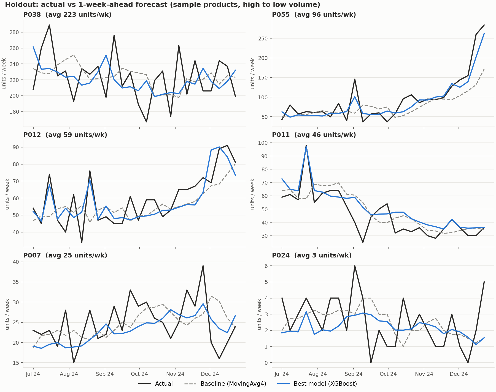
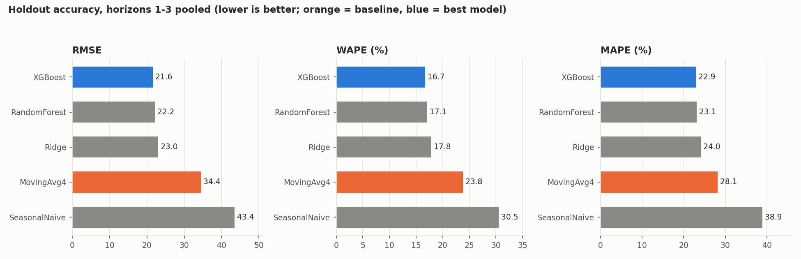
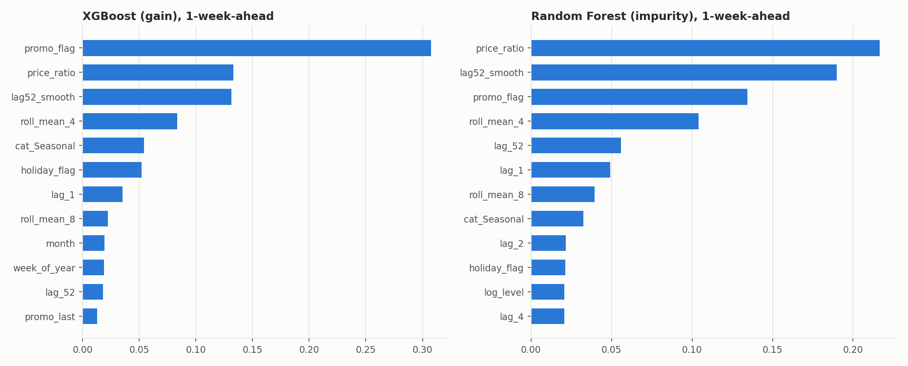
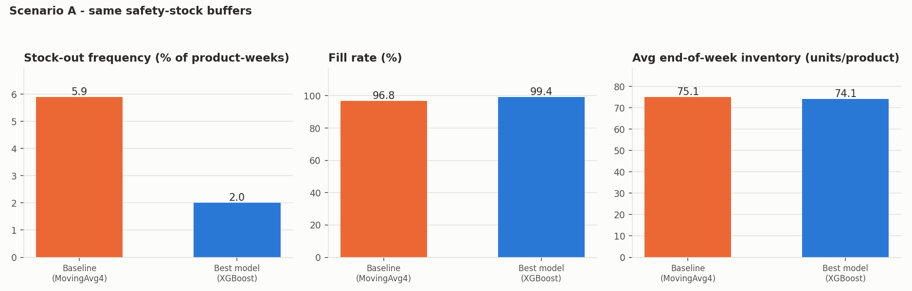
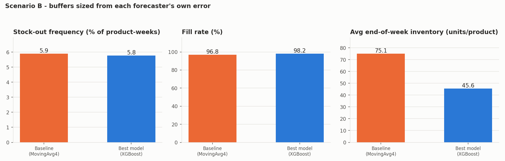
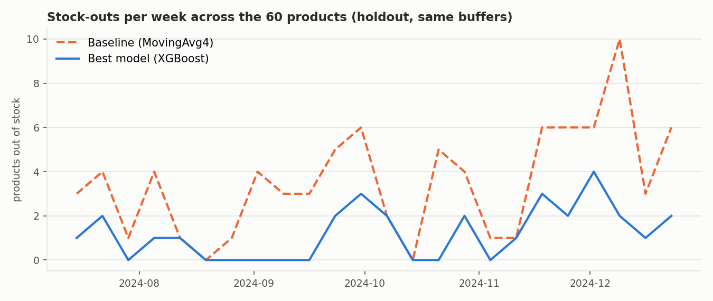

# Sales Demand Forecasting + Reorder Simulation

Weekly product-level demand forecasting with Ridge / Random Forest / XGBoost, benchmarked against a
seasonal-naive and a moving-average baseline, and then pushed through a reorder-point (order-up-to) policy to
estimate the effect on stock-outs, fill rate and inventory.

> **Data notice: the dataset is SYNTHETIC.** It is generated by `src/data_gen.py` with a fixed seed (42). No real
> company data is used, so absolute numbers (RMSE, stock-out rates) say nothing about any real business. The value of
> the project is the *method*: leakage-safe features, strict time-based validation, honest baselines and a
> forecast-to-inventory simulation. The code accepts a real dataset with the same columns (see "Using your own data").

## 1. Problem

A retailer must decide how much of each product to order. Orders take 2 weeks to arrive, so the decision depends on
forecast demand over the next 3 weeks. Over-ordering ties up cash; under-ordering loses sales. Question: **do ML
forecasts beat simple baselines, and does the improvement translate into fewer stock-outs without more inventory?**

## 2. Data (synthetic)

* 60 products x 208 weeks (2021-01-04 to 2024-12-30), 5 categories, every 8th product a slow mover (zero-demand weeks occur).
* Demand = base level x product trend x yearly seasonality (category-specific peak, 2 harmonics) x holiday uplift x promo lift
  x price elasticity, with over-dispersed Poisson noise.
* Promotions (1-2 week events with a 10-30% price cut), list-price steps, and a US-style retail holiday calendar.
* **Deliberate data problems are injected** so the cleaning step is real: absent weeks, blank values, negative values
  (returns), and 4-10x outlier spikes. Clean ground truth is stored in `data/synthetic_ground_truth.csv` and used only for a
  cleaning sanity report - never as a model input.

Files: `data/raw_sales.csv` (what a real extract would look like), `data/clean_weekly_sales.csv` (after cleaning).

### Cleaning decisions (`src/data_prep.py`)

| Problem | Decision | Why |
|---|---|---|
| Missing weeks (63 absent rows, 64 blank values) | Re-index to a full product x week grid; fill with a **causal forward-fill** (max 4 weeks); every filled week is flagged `is_imputed` and **excluded from all scoring** | Interpolating would use future values; and a model should never be scored against a number we made up |
| Negative units (24) | Treated as returns/booking errors -> set to missing, then handled as above. **Not** clipped to 0 | Clipping fabricates "zero demand" weeks |
| Outliers (59 weeks flagged) | **Causal** robust rule: > median + 5 x robust sigma of the *previous* 13 weeks (and > 3.5x median in promo/holiday weeks, where real spikes are expected). Flagged values are **winsorised** to that bound, not deleted | Never looks into the future; keeps a (capped) signal that something sold |
| Zero demand (1.8% of product-weeks) | Kept as genuine zeros | Slow movers really sell nothing some weeks; MAPE handles them explicitly (below) |
| Duplicates | None found; would be summed | - |

Sanity check against the known truth (synthetic data only): the rule flagged 33 of the 34 injected outliers and also
26 normal weeks (false positives), and the cleaned series is on average within 0.28 units of true demand on non-imputed weeks.

## 3. Approach

**Forecast set-up - direct multi-horizon.** At the end of week *o* we forecast demand for weeks *o+1*, *o+2*, *o+3*
(one model per horizon, one global model across all products). Three weeks is the protection interval of the reorder
policy (2-week lead time + 1-week review period), so those are exactly the forecasts the inventory logic needs.

**Baselines** (`src/models.py`): *seasonal naive* (same week last year, y[t-52]) and *4-week moving average* (flat forecast).
Both are reported; **the stronger one on the validation block is "the baseline"** (chosen on validation so the holdout is not used for selection).

**Models**: Ridge (the "Linear Regression" - ridge penalty tuned), Random Forest, XGBoost. No deep learning.

**Features** (`src/features.py`, 18 numeric + 5 category one-hots), all built only from information available at the forecast origin:

| Group | Features |
|---|---|
| Lags | `lag_1`, `lag_2`, `lag_4` (most recent 1st/2nd/4th observation at the origin), `lag_52` (same week last year), `lag52_smooth` (3-week average around it) |
| Rolling | mean and std over the last 4 and 8 weeks, `log_level` (trailing 13-week mean) |
| Calendar (of the target week) | week-of-year, month, sin/cos of week-of-year, holiday flag |
| Planned drivers (of the target week) | promo flag, price ratio (price / recent median list price), `promo_last` |
| Product | category one-hots |

Demand features and the target are divided by the trailing 13-week mean at the origin ("level") so one global model serves
products from 1 to 400 units/week; predictions are multiplied back. Training rows are weighted by level.

**Leakage - checked explicitly, three ways:**
1. *Perturbation test* (`features.assert_no_leakage`, run on every pipeline run and in `tests/`): replace all demand after a cut-off week
   with garbage (and scramble planned price/promo beyond the target), rebuild the features, and assert that every row whose forecast origin is
   at or before the cut-off is **identical**. Passed for all 3 horizons (5 cut-offs each, ~24k rows per horizon).
2. *Label purge*: a training row is only used if its label was known when the first forecast of the evaluation block was issued
   (target <= first eval week - h). `TimeSeriesSplit(gap = h-1)` does the same inside CV.
3. *Holdout lock*: `evaluate.HoldoutLock` raises if the holdout is evaluated twice.

Assumption: promotion flags and prices for the target week are *planned in advance* (known at forecast time). If your promo calendar is not
fixed that early, remove `promo_flag`, `price_ratio` (and expect worse accuracy).

**Validation (chronological, never shuffled):**

| Block | Weeks (target) | Used for |
|---|---|---|
| Train | 2022-01-10 .. 2023-12-25 (103 wks) | fitting; **hyper-parameter tuning by walk-forward CV** (`TimeSeriesSplit`, 5 folds x 10 weeks, expanding window) |
| Validation | 2024-01-01 .. 2024-06-24 (26 wks) | choosing the baseline and best model; estimating forecast-error std for safety stock |
| Holdout | 2024-07-01 .. 2024-12-23 (26 wks) | **evaluated once**, models refit on train+validation |

(The first 53 weeks only provide lag history.)

**Metrics**: RMSE (units), MAPE, WAPE. Percentage error is undefined when actual demand is 0, so **MAPE is computed only on rows with
actual > 0** and the number of excluded rows is reported; **WAPE = sum|error| / sum(actual)** keeps every row and is the metric to trust for relative accuracy.
Imputed weeks are excluded from all metrics. Headline numbers pool the 1-, 2- and 3-week-ahead forecasts.

## 4. Reorder logic and stock-out simulation (`src/inventory_sim.py`)

Periodic-review **order-up-to** policy, evaluated week by week over the 26-week holdout for every product:

```
S_t = sum of forecast demand over the next (L + R) weeks  +  z * sigma_LR
order_t = max(0, ceil(S_t - (on-hand + on-order)))     # arrives L weeks later
```

| Assumption | Value |
|---|---|
| Lead time L | 2 weeks |
| Review period R | 1 week (order every week) |
| Target (cycle) service level | 95% -> z = 1.645 (also 90% and 98% as sensitivity) |
| Unmet demand | **Lost** (no back-orders) |
| Starting stock | identical for every forecaster: one week of cover (average of the last 4 pre-holdout weeks); pipeline seeded with the same rate |
| sigma_LR | std-dev of the 3-week-aggregate forecast error per product on the **validation** block (out-of-sample, before the holdout) |
| Warm-up | the first L = 2 weeks are dropped from the metrics: they are driven only by the identical initial conditions |
| Holding cost (cost proxy) | 20% of the unit price per year |
| Lost-sale cost (cost proxy) | 30% of unit price per unit of unmet demand (lost margin; no goodwill penalty) |
| Capacity, MOQ, price breaks, shelf life, multi-echelon, substitution | not modelled |

The baseline and the best model go through the **identical** simulation: same lead time, starting stock, service level and demand. Metrics:
stock-out frequency (share of product-weeks with unmet demand), fill rate (served / demanded units), average end-of-week inventory, plus a cost proxy.

Two scenarios are reported because they answer different questions, and **the result depends on which you choose**:

* **A - same buffers (drop-in forecast swap):** safety stock is sized from the baseline's error and used for both forecasters, so only the forecast changes.
* **B - own-error buffers:** each forecaster's safety stock uses its own error std. A more accurate forecast earns a smaller buffer, so at the *same* target service level
  the benefit shows up as lower inventory rather than fewer stock-outs.

## 5. Results

All numbers below are written by `run_all.py` into this README (and `outputs/results_summary.md`) - nothing is typed by hand.

<!-- RESULTS:START (auto-generated by run_all.py - do not edit by hand) -->
### Forecast accuracy - final holdout (2024-07-01 to 2024-12-23, evaluated once)

Pooled over 1-, 2- and 3-week-ahead forecasts (4,614 product-week forecasts). Baseline = **MovingAvg4** (the stronger of the
two baselines on the validation block); best model = **XGBoost** (lowest validation RMSE). Units are items per product-week.

| model | RMSE | MAPE_% | WAPE_% | Bias_units | role |
|---|---|---|---|---|---|
| SeasonalNaive | 43.44 | 38.92 | 30.48 | -1.20 | baseline |
| MovingAvg4 | 34.43 | 28.14 | 23.83 | -2.60 | baseline (stronger on validation) |
| Ridge | 22.96 | 24.05 | 17.83 | -0.32 | model |
| RandomForest | 22.18 | 23.10 | 17.11 | -0.79 | model |
| XGBoost | 21.60 | 22.95 | 16.72 | -0.91 | best model (by validation) |

Per-horizon RMSE:

| model | RMSE h=1 | RMSE h=2 | RMSE h=3 |
|---|---|---|---|
| SeasonalNaive | 43.44 | 43.44 | 43.44 |
| MovingAvg4 | 31.60 | 34.19 | 37.26 |
| Ridge | 22.17 | 22.97 | 23.73 |
| RandomForest | 21.87 | 22.12 | 22.54 |
| XGBoost | 21.19 | 21.51 | 22.08 |

* **XGBoost vs MovingAvg4: RMSE 37.3% lower, WAPE 29.8% lower** (relative).
* MAPE is computed only where actual demand > 0; 96 zero-demand forecasts were excluded from MAPE (they stay in RMSE and WAPE).
* The model chosen on validation is also the best model on the holdout by RMSE (holdout best: XGBoost).

### Reorder simulation - holdout, 2-week lead time, 95% target service level, identical starting stock

Two ways of running the *same* policy are reported because they answer different questions.

**Scenario A - same buffers (drop-in forecast swap).** Safety stock is sized from the baseline's validation error std and applied to both
forecasters, so only the forecast changes.

|  | Baseline (MovingAvg4) | Best model (XGBoost) |
|---|---|---|
| Stock-out events (product-weeks) | 85.00 | 29.00 |
| Stock-out frequency (%) | 5.90 | 2.01 |
| Fill rate (%) | 96.85 | 99.35 |
| Units lost | 3172.00 | 650.00 |
| Avg end-of-week inventory (units/product) | 75.13 | 74.13 |
| Cost proxy | 13061.66 | 5666.18 |

**Stock-out events: 65.9% reduction** vs baseline (95% bootstrap CI over products for the reduction: 48.6% to 79.7%). Units lost: 79.5% reduction. Fill rate: +2.51 pts. **Average inventory is 1.3% lower.** Cost proxy: -56.6%.

**Scenario B - buffers sized from each forecaster's own error.** A more accurate forecast earns a smaller safety stock.

|  | Baseline (MovingAvg4) | Best model (XGBoost) |
|---|---|---|
| Stock-out events (product-weeks) | 85.00 | 83.00 |
| Stock-out frequency (%) | 5.90 | 5.76 |
| Fill rate (%) | 96.85 | 98.22 |
| Units lost | 3172.00 | 1791.00 |
| Avg end-of-week inventory (units/product) | 75.13 | 45.58 |
| Cost proxy | 13061.66 | 7544.37 |

**Stock-out events: 2.4% reduction** vs baseline (95% bootstrap CI over products for the reduction: -29.4% to 26.5%). Units lost: 43.5% reduction. Fill rate: +1.37 pts. **Average inventory is 39.3% lower.** Cost proxy: -42.2%.

All models through scenario A:

| forecaster | stockout_events | fill_rate_% | avg_inventory_units |
|---|---|---|---|
| MovingAvg4 (baseline) | 85 | 96.85 | 75.13 |
| Ridge | 37 | 98.98 | 76.46 |
| RandomForest | 33 | 99.26 | 74.97 |
| XGBoost | 29 | 99.35 | 74.13 |

Sensitivity to the target service level (A = same buffers, B = own-error buffers; reduction = % fewer stock-out events, inventory change = % change in average inventory):

| service_level | A_base_events | A_model_events | A_reduction_% | A_inventory_change_% | B_base_events | B_model_events | B_reduction_% | B_inventory_change_% |
|---|---|---|---|---|---|---|---|---|
| 0.90 | 130.00 | 61.00 | 53.08 | -3.86 | 130.00 | 119.00 | 8.46 | -38.78 |
| 0.95 | 85.00 | 29.00 | 65.88 | -1.33 | 85.00 | 83.00 | 2.35 | -39.33 |
| 0.98 | 58.00 | 19.00 | 67.24 | 0.34 | 58.00 | 50.00 | 13.79 | -39.81 |
<!-- RESULTS:END -->

### Charts (`outputs/figures/`)

| | |
|---|---|
|  |  |
|  |  |
|  |  |

### How to read the results honestly

* The learned models beat both baselines by a wide margin here, but this is synthetic data in which promotions, price and holidays have a clean, strong effect and the baselines
  ignore them. Real data is noisier; expect a smaller gap.
* The three learned models are close to each other (Random Forest and XGBoost are within a few percent of each other); the choice among them is not a large effect.
* Seasonal naive is *worse* than the moving average because last year's single week carries its own Poisson noise, promo timing and holiday alignment - not because seasonality is absent.
* The stock-out reduction is large when buffers are held fixed (A) but is **zero** when each forecaster's buffer is re-sized to its own error at the same service level (B): in B the improvement is converted into
  roughly 40% less inventory and fewer lost units instead. Both views are legitimate; they are different business levers (service vs. working capital).
* The 95% bootstrap interval resamples products (not weeks) and the simulation uses 26 weeks, so the stock-out counts (tens of events) are small and noisy.

## 6. Limitations

* Synthetic data from one fixed seed: a single draw, no confidence interval across datasets. Results can differ with another seed or real data.
* Sales are treated as demand. In real data, stock-outs censor sales, which biases history and forecasts low.
* Promo flags and prices are assumed known in advance; promo/price decisions are not modelled as being reactive to forecasts.
* Direct models are trained once per block and are **not** refit weekly during the holdout; no online updating.
* Safety stock assumes forecast errors are roughly independent of the level and uses only ~24 validation origins per product to estimate sigma.
* Single-location, single-echelon lost-sales policy; no order costs, minimum order quantities, capacity or supplier variability. The cost proxy uses illustrative rates.
* Hyper-parameter grids are small (5 / 8 / 8 configurations) to keep the run to a few minutes.
* The holdout is 26 weeks - one half-year of seasonality (July-December).

## 7. How to run

```bash
python -m venv .venv && source .venv/bin/activate        # Windows: .venv\Scripts\activate
pip install -r requirements.txt
python run_all.py            # full run: ~3-4 minutes, writes data/, outputs/, and refreshes this README's results block
python run_all.py --fast     # ~1 minute smoke test with smaller grids (numbers will differ slightly)
python -m pytest -q          # unit tests (or: python tests/test_pipeline.py)
jupyter notebook notebooks/01_eda_and_results.ipynb      # EDA + results, reads the files written by run_all.py
```

Everything is seeded (`SEED = 42` in `src/config.py`). Re-running reproduces the tables; tiny floating-point differences are possible across
library versions/platforms.

### Using your own data
Provide `data/raw_sales.csv` with columns `product_id, category, week_start (Monday), units_sold, price, promo_flag` (weekly or aggregated to weekly first),
comment out `data_gen.main()` in `run_all.py`, and adjust the `CATEGORIES` list in `src/features.py` if your categories differ.

## 8. Repository layout

```
sales-demand-forecasting/
|-- run_all.py                 # end-to-end pipeline
|-- requirements.txt  .gitignore  README.md
|-- data/                      # raw_sales.csv, clean_weekly_sales.csv, synthetic_ground_truth.csv
|-- notebooks/01_eda_and_results.ipynb
|-- src/
|   |-- config.py              # all constants / assumptions
|   |-- data_gen.py            # synthetic generator (fixed seed)
|   |-- data_prep.py           # cleaning
|   |-- features.py            # calendar, leakage-safe features, splits, leakage test
|   |-- models.py              # baselines, model factories, walk-forward tuning
|   |-- evaluate.py            # metrics, holdout lock, charts
|   `-- inventory_sim.py       # order-up-to policy + simulation
|-- tests/test_pipeline.py
`-- outputs/                   # metrics CSVs, results.json, results_summary.md, figures/
```
